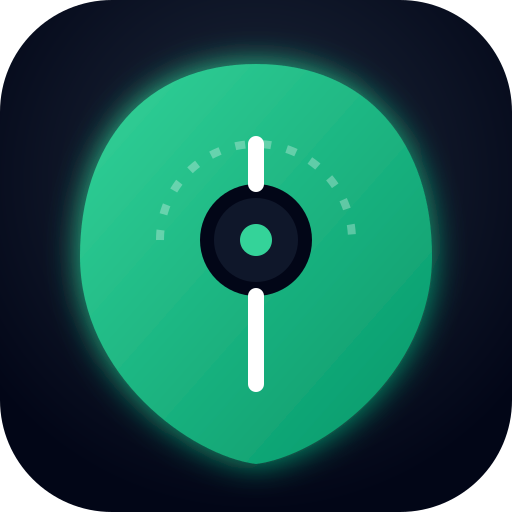
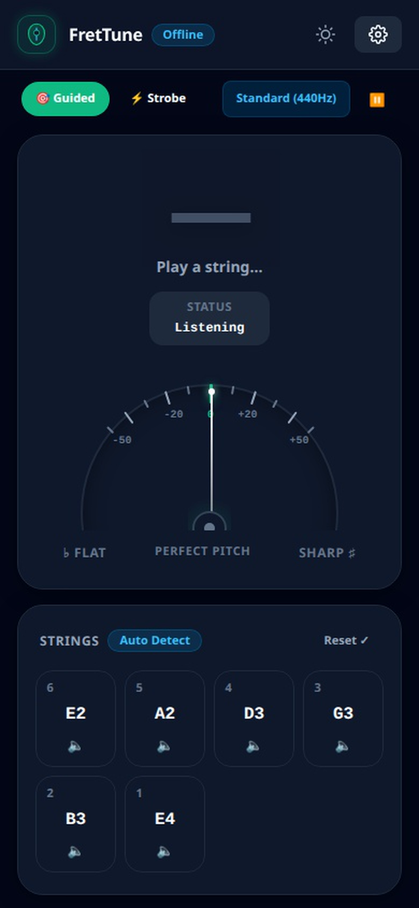
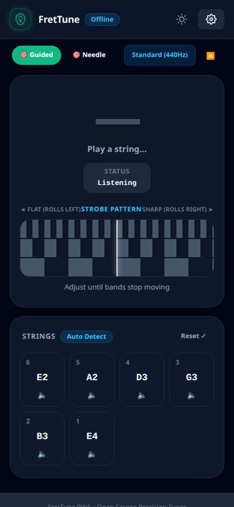
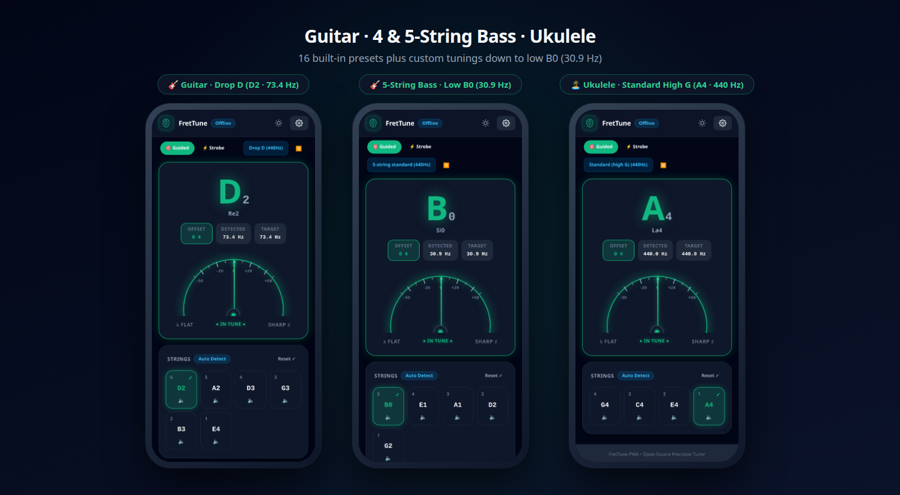
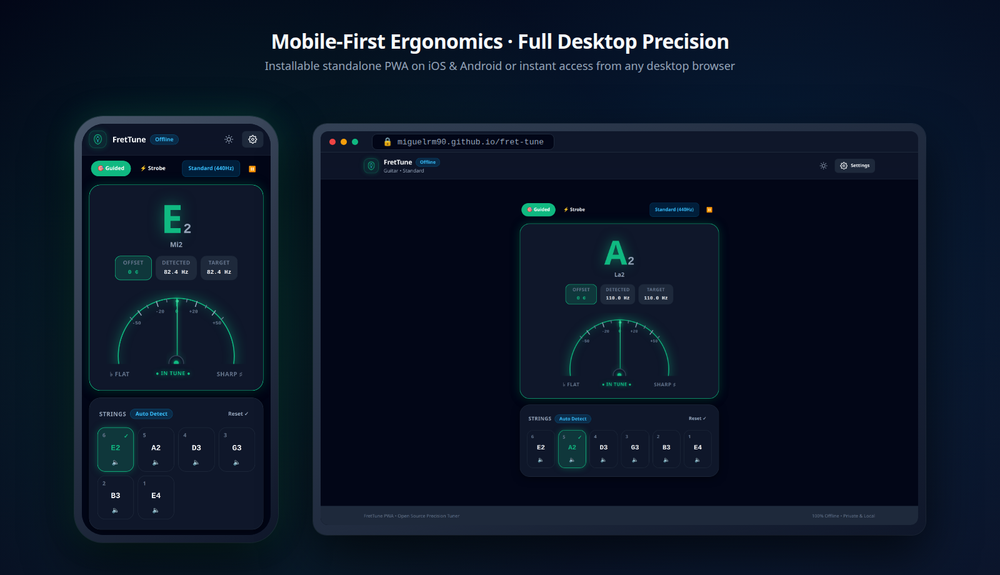
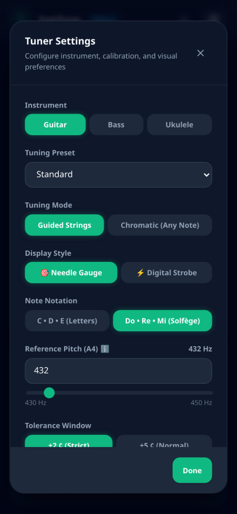
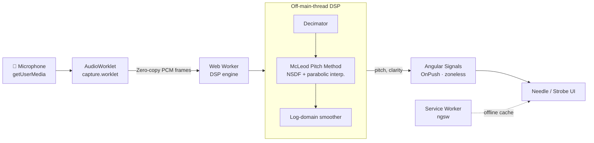

<div align="center">



# FretTune

### The precision tuner that opens in one tap, works offline and never shows you an ad.

Guitar · Bass · Ukulele — Needle & Strobe modes — 100% local audio processing

[](https://miguelrm90.github.io/fret-tune/)

[](https://github.com/MiguelRM90/fret-tune/actions/workflows/deploy.yml)
[](https://web.dev/progressive-web-apps/)
[](#-how-it-works)
[](https://developer.mozilla.org/docs/Web/API/AudioWorklet)
[](https://angular.dev)
[](tsconfig.json)
[](#-privacy)
[](LICENSE)

<br />



</div>

---

## 🎸 Why FretTune?

Free tuner apps have become ad delivery platforms: full-screen interstitials between strings, "Pro" paywalls for basic features, unnecessary permissions and 40 MB downloads — just to hear if your E is flat.

**FretTune is the opposite:**

| | Typical "free" tuner app | **FretTune** |
|---|---|---|
| Ads | Banners + interstitials | **None. Ever.** |
| Install | App store, account, updates | **Open a URL** (install optional) |
| Works offline | Sometimes | **Always** (Service Worker) |
| Your audio | Unknown | **Never leaves your device** |
| Strobe mode | Paid tier | **Free** |
| Source code | Closed | **MIT, auditable** |

<div align="center">



</div>

---

## ✨ Features

**Tuning**
- 🎯 **Needle gauge** — fluid analog meter (±50 cents) with reactive color feedback.
- ⚡ **Digital strobe** — multi-band phase-locked pattern that freezes when you are dead-on.
- 🎼 **Guided mode** — interactive string checklist with per-string lock and completion indicator (✓).
- 🌈 **Chromatic mode** — automatic detection across any musical note and octave.
- 🔊 **Reference tones** — play pure target pitches for any string directly from the UI.

**Instruments & tunings**
- **6-String Guitar**: Standard, Half step down, Drop D, Drop C, DADGAD, Open G, Open D, Open E.
- **4 & 5-String Bass**: Standard, Half step down, Drop D, 5-string standard (low B0 ~30.9 Hz).
- **Ukulele**: Standard (high G), Low G, D tuning, Baritone.
- **Custom Tunings**: Define and save your own custom string configurations (3 to 12 strings).

<div align="center">



</div>

**Pro calibration & ergonomics**
- 🎛️ Concert pitch **A4 calibration** from **430 Hz to 450 Hz** (default 440 Hz).
- 📏 Tolerance windows: **Strict (±2¢) · Normal (±5¢) · Relaxed (±10¢)**.
- 🌐 Note naming in **Anglo-Saxon letters (C · D · E)** or **Latin solfège (Do · Re · Mi)**.
- 📳 **Haptic feedback** upon hitting target pitch, **Screen Wake Lock**, and **Dark / Light themes**.

<div align="center">



</div>

---

## ▶️ Try it in one click

1. Open **[miguelrm90.github.io/fret-tune](https://miguelrm90.github.io/fret-tune/)** on your phone or laptop.
2. Allow microphone access.
3. Pluck a string.

> 💡 **Install it (optional):** use *Add to Home Screen* on iOS/Android or the install icon in Chrome/Edge's address bar. After the first visit it works **100% offline**.

<details>
<summary><b>📷 Scan QR to open on your phone</b></summary>
<br />
<div align="center">
  
</div>
</details>

<details>
<summary><b>🎛️ Preview calibration & settings modal</b></summary>
<br />
<div align="center">
  
</div>
</details>

---

## 🧠 How it works



| Layer | Implementation |
|---|---|
| Capture | `AudioWorklet` (`capture.worklet.ts`) — low-latency PCM capture with recyclable `ArrayBuffer` pool. |
| Analysis | Dedicated **Web Worker** running a pure TypeScript **McLeod Pitch Method (NSDF)** with FFT acceleration and parabolic interpolation (YIN also available via detector registry). |
| Stabilization | Low-pass decimation for bass frequencies + log-domain exponential smoothing and median filtering. |
| UI | Angular 22 standalone components, **Signals**, `OnPush`, zoneless reactive change detection. |
| Design system | [`pwa-ui-core`](https://github.com/MiguelRM90/pwa-ui-core) — native CSS tokens and standalone components, zero Tailwind. |
| Offline | `@angular/service-worker` prefetching all app bundles, icons and worklets. |
| Security | CI verifies **CSP (`strict-dynamic` + SHA-256), SRI (`sha384`) and `ngsw.json` allowlist** on every build; GitHub Actions pinned by commit SHA. |

<details>
<summary><b>📂 Project structure</b></summary>

```text
src/app/
├── core/
│   ├── audio-engine/   # Mic input, audio lifecycle, reference tone generator, pitch service
│   ├── dsp/            # McLeod (MPM), YIN, FFT, decimator, pitch smoother (+ specs & bench)
│   ├── music/          # Instruments, tunings, custom tunings, note naming & reading resolver
│   ├── services/       # Signal stores (tuner, settings, checklist), haptics, wake-lock, SW updates
│   ├── workers/        # AudioWorklet capture + DSP Web Worker + typed message protocol
│   ├── models/ constants/ utils/
├── features/
│   ├── tuner/          # Needle gauge, strobe display, string selector, note display, mic prompt
│   └── settings/       # Calibration, notation, instrument & custom tuning modal
└── shared/             # Header, toggle-switch, note-name & cents pipes
```
</details>

---

## 🔒 Privacy

- Audio is processed **in memory, on your device**. Nothing is recorded, uploaded or stored.
- No analytics, no cookies, no third-party scripts.
- Strict Content Security Policy (`default-src 'self'`, `connect-src 'self'`, anti-framing guard) verified automatically in CI.

---

## 🛠️ Local development

**Prerequisites:** Node.js 24 · `pnpm` · the [`pwa-ui-core`](https://github.com/MiguelRM90/pwa-ui-core) repository cloned **next to** this one (`../pwa-ui-core`).

```bash
# 1. Clone both repositories side by side
git clone https://github.com/MiguelRM90/pwa-ui-core.git
git clone https://github.com/MiguelRM90/fret-tune.git
cd fret-tune

# 2. Install dependencies
pnpm install

# 3. Build the AudioWorklet and start the dev server
pnpm start
```

Navigate to `http://localhost:4200/` and allow microphone access.

| Script | Description |
|---|---|
| `pnpm start` | Bundle `capture.worklet.ts` and start the development server |
| `pnpm test` | Static security scan + zero-dependency unit test suite (`node --test`) |
| `pnpm bench` | Run the McLeod pitch detector performance benchmark |
| `pnpm build:gh-pages` | Production build with `--base-href /fret-tune/` + CSP/SRI/`ngsw.json` verification |

---

## 📄 License

[MIT](LICENSE) © [MiguelRM90](https://github.com/MiguelRM90)
